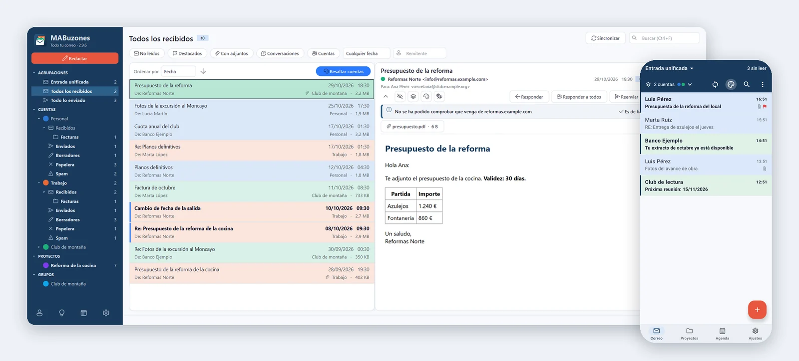
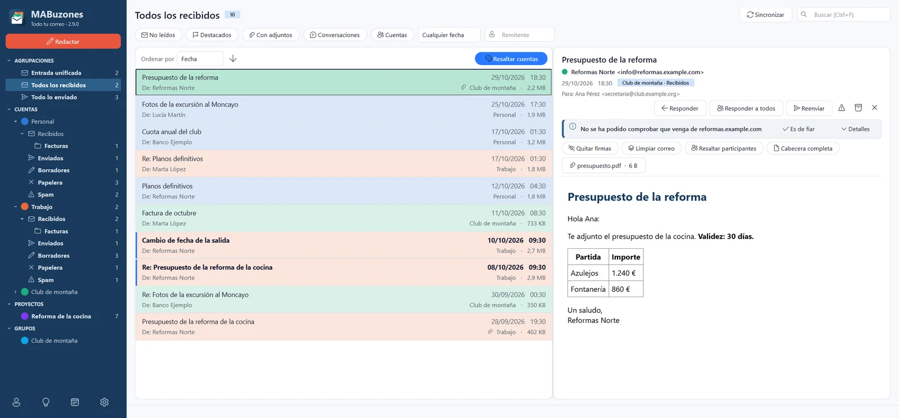
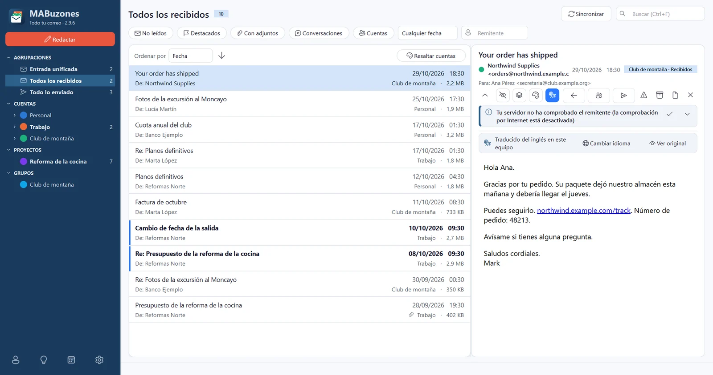
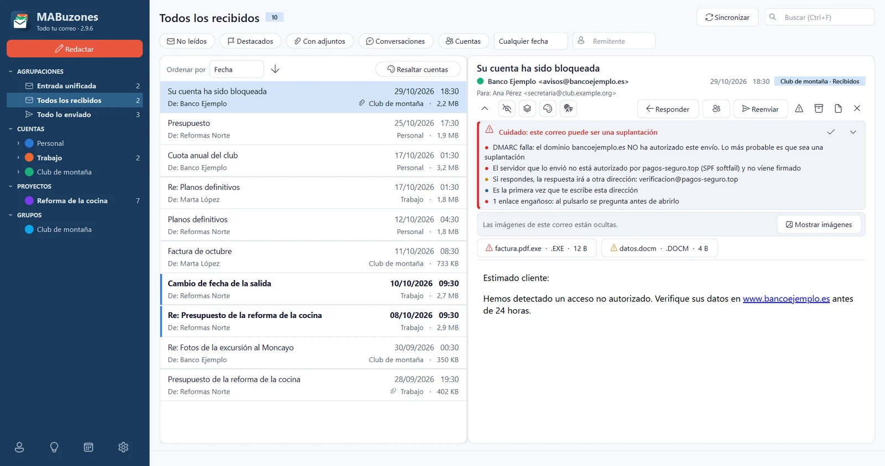
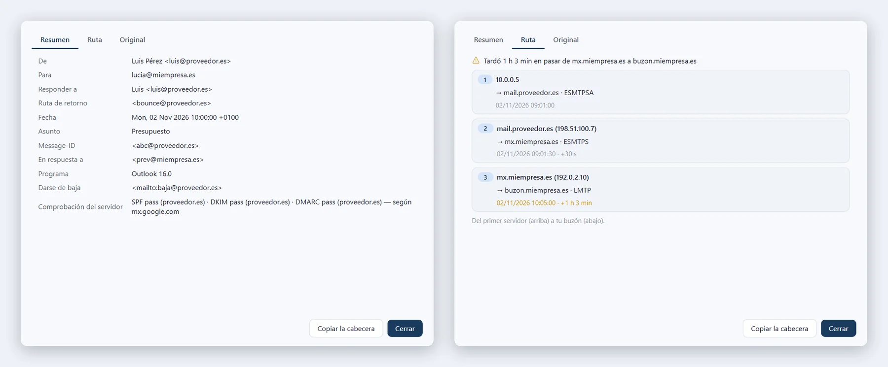
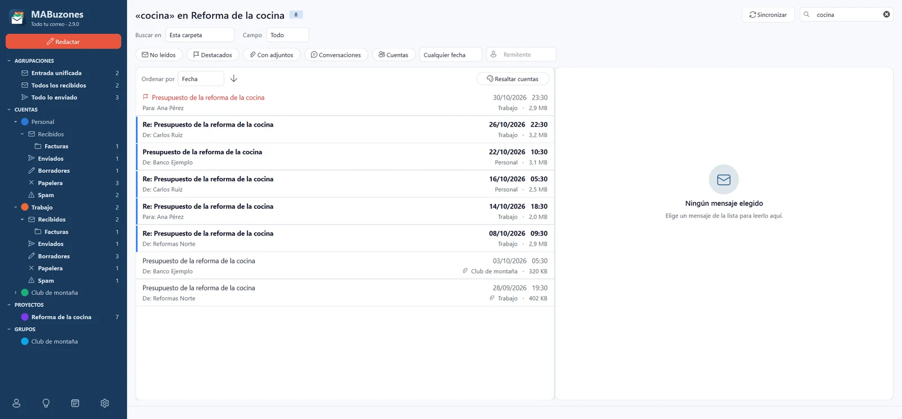
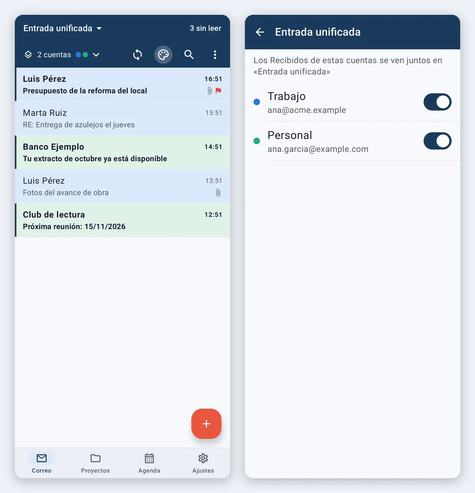
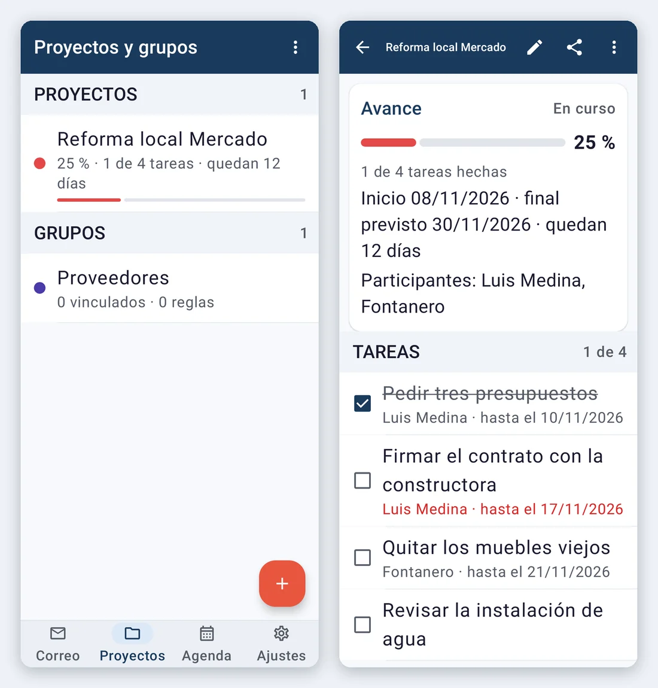
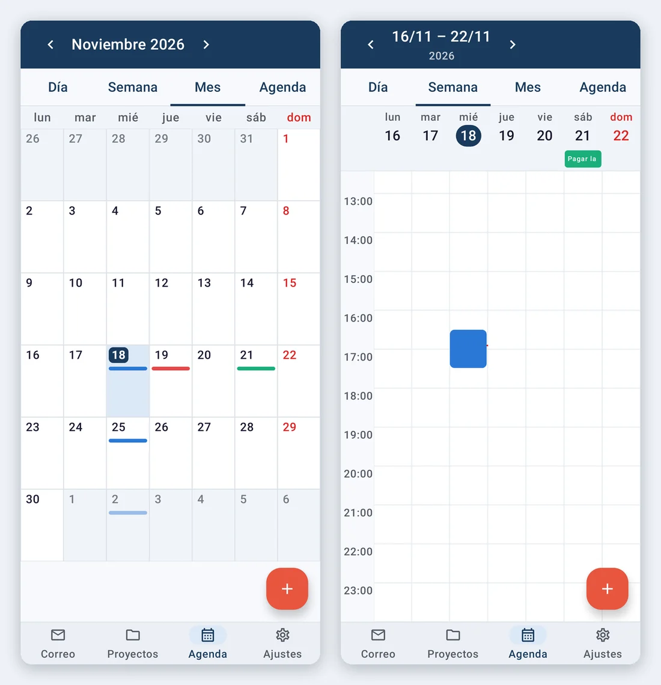
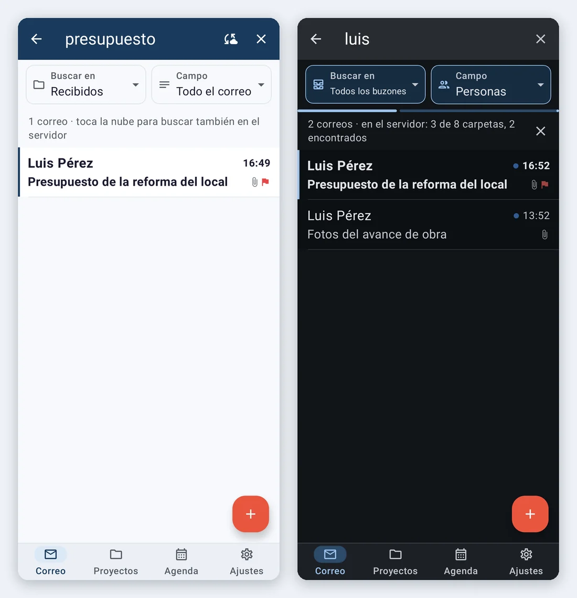

# MABuzones

Gestor de correo personal para el ordenador y el móvil: todas tus cuentas con su color, conversaciones limpias por persona, avisos de correos falsos con la cabecera al detalle y proyectos con plan, tareas y avance. Todo guardado en tu equipo y cifrado.

**Aplicación gratuita para Windows y Android desarrollada por [Masoft.es](https://masoft.es)**

- **Windows 2.9.6:** [instalador](https://github.com/MaSoft/MABuzones/releases/download/escritorio-v2.9.6/MABuzones_Setup_v2.9.6.exe) o [ejecutable único](https://github.com/MaSoft/MABuzones/releases/download/escritorio-v2.9.6/MABuzones_v2.9.6.exe)
- **Android 1.9.7:** [APK](https://github.com/MaSoft/MABuzones/releases/download/android-v1.9.7/MABuzones-1.9.7.apk)

Más información y los manuales también en [masoft.es](https://masoft.es/descargas.html#mabuzones).

Cada equipo descarga el correo de su servidor; entre el PC y el móvil solo viaja la configuración (cuentas, colores, agrupaciones, proyectos, reglas, firmas y agenda), por la Wi-Fi, emparejados con un código QR y cifrado.

## Windows 2.9.6

**Windows 10 / 11 · 64 bits** · [Página de la versión](https://github.com/MaSoft/MABuzones/releases/tag/escritorio-v2.9.6)

- **Instalador:** [`MABuzones_Setup_v2.9.6.exe`](https://github.com/MaSoft/MABuzones/releases/download/escritorio-v2.9.6/MABuzones_Setup_v2.9.6.exe) · 192 MB · SHA-256 `4eec97e58f10dd00ce2d7209e921675e1d6c1f327a86c320552b7c049d81c19b`
- **Ejecutable único (sin instalar):** [`MABuzones_v2.9.6.exe`](https://github.com/MaSoft/MABuzones/releases/download/escritorio-v2.9.6/MABuzones_v2.9.6.exe) · 273 MB · SHA-256 `3fa60841f26fc8fa1f9cd35741976690f5acc6b362f93dc00b08d49554046bfe`

### Qué hace
- Todas tus cuentas en un sitio: IMAP, POP3, Gmail y Outlook.com (iniciando sesión en el navegador), cada una con su color.
- Entrada unificada y agrupaciones de bandejas a tu gusto; «Resaltar cuentas» pinta cada correo con el color de su cuenta.
- Limpiar correo: la conversación en un bloque por mensaje, sin lo repetido; «Quitar firmas» reconoce las firmas, avisos legales y pies de los programas de correo más usados, y lo que le enseñas lo aprende.
- Resaltar participantes: un color por persona en toda la conversación, con su leyenda.
- Traductor de correos en tu equipo: reconoce el idioma y lo traduce al español sin que el correo salga del ordenador, con el original a un clic.
- Avisos de correos falsos: quién lo envía de verdad (SPF, DKIM, DMARC), nombres parecidos, enlaces engañosos y adjuntos peligrosos.
- Cabecera completa: resumen legible, la ruta por los servidores con lo que tardó cada salto y el texto original.
- Grupos para reunir los correos de un tema y Proyectos con fechas, participantes, tareas y avance, con su panel e informe; sus correos se pueden descargar dentro para que no se pierdan aunque se muevan o borren en el servidor.
- Búsqueda en la carpeta, el buzón o todas las cuentas, por asunto, personas o texto; filtros en todas las vistas.
- Reglas generales y por cuenta, bloquear remitentes o dominios, Agenda con avisos y un Asistente que responde sobre tu correo.
- Archivos .pst y Thunderbird sin Outlook: abrirlos, importarlos y exportar las carpetas locales a .pst.

### Requisitos

| | |
|---|---|
| Sistema | Windows 10 u 11 de 64 bits |
| Instalación | Instalador para tu usuario, sin permisos de administrador, o ejecutable único que se copia y se abre; no hace falta instalar nada más. |
| Cuentas | Cualquier correo con IMAP o POP3; Gmail y Outlook.com también iniciando sesión en el navegador. |
| Con el móvil | PC y móvil en la misma red y el puerto 48010 permitido en el cortafuegos para redes privadas. |
| Traductor | Cada idioma se descarga la primera vez que hace falta (lo pregunta antes); después traduce sin conexión. |

### Capturas

| | |
|---|---|
|  **Cuentas por colores.** Entrada unificada con cada correo del color de su cuenta y la vista previa compacta. |  **Limpiar correo.** La misma conversación tal cual y limpia: un bloque por persona, con su color. |
|  **Traductor.** El correo traducido al español en tu equipo, con el original a un clic. |  **Avisos de seguridad.** Franja del remitente con lo que no cuadra y «Es de fiar». |
|  **Cabecera completa.** Resumen, ruta por los servidores y el original. |  **Proyectos.** Avance, fechas, participantes y tareas del proyecto. |
|  **Búsqueda y filtros.** En la carpeta, el buzón o todas las cuentas. |  **Agenda.** Citas con aviso creadas desde un correo. |
|  **Asistente.** Preguntas sobre tu correo, respondidas en tu equipo. |  |

## Android 1.9.7

**Android 13 o superior** · [Página de la versión](https://github.com/MaSoft/MABuzones/releases/tag/android-v1.9.7)

- **APK:** [`MABuzones-1.9.7.apk`](https://github.com/MaSoft/MABuzones/releases/download/android-v1.9.7/MABuzones-1.9.7.apk) · 84,1 MB · SHA-256 `d4e8a829972ad14c28b3e5a4b8ef763ed115cef0dafa802031994447de06308d`

### Qué hace
- Tus cuentas IMAP, Gmail y Outlook.com en el móvil, cada una con su color, y la Entrada unificada.
- El móvil descarga el correo de su servidor por su cuenta; con el PC solo comparte la configuración.
- Búsqueda en la carpeta, el buzón o todas las cuentas, también en el servidor lo que el móvil aún no tiene.
- Franja de seguridad del remitente, enlaces engañosos con pregunta y adjuntos peligrosos bloqueados, igual que en el PC.
- Ver cabecera completa: resumen, ruta por los servidores y original.
- Limpiar correo, Quitar firmas y Resaltar participantes también en el móvil.
- Traductor de correos en el propio móvil: lo traduce al español sin que el correo salga del teléfono.
- Proyectos con avance, fechas, participantes y tareas que se marcan con el dedo; grupos de correos, que se pueden descargar dentro para tenerlos siempre.
- Agenda con mes, semana y lista; reglas de correo; avisos de correo nuevo.
- Bloqueo con PIN o huella y todo cifrado en el móvil.

### Requisitos

| | |
|---|---|
| Sistema | Android 13 o superior |
| Internet | Para leer y enviar el correo; la sincronización con el PC va por la Wi-Fi de casa u oficina. |
| Instalación | Se descarga el APK en el móvil y se abre; Android pide permiso para instalar aplicaciones de esa fuente. |
| Actualizar | La versión nueva se instala encima de la anterior sin perder nada. |
| Traductor | Cada idioma se descarga la primera vez (lo pregunta antes); después traduce sin conexión. |

### Capturas

| | |
|---|---|
|  **Cuentas por colores.** Entrada unificada y la lista con el color de cada cuenta. |  **Seguridad.** Aviso de suplantación con sus detalles. |
|  **Cabecera completa.** Resumen y ruta por los servidores. |  **Proyectos.** Avance, fechas y tareas que se marcan con el dedo. |
|  **Agenda.** Mes, semana y lista con las citas de tus correos. |  **Búsqueda.** Dónde y qué buscar, también en el servidor. |

## Instalación y comprobación

- **Windows:** el instalador y el ejecutable no están firmados digitalmente: Windows puede mostrar «Windows protegió su PC». Pulsa «Más información» y «Ejecutar de todas formas».
- **Android:** la aplicación no está en Google Play. Se descarga el APK en el móvil y se abre; Android pide permiso para instalar aplicaciones de esa fuente y Google Play Protect puede avisar de que no conoce la aplicación.

Para comprobar una descarga, en PowerShell `Get-FileHash .\<archivo>` debe dar la huella SHA-256 de arriba.

## Aviso legal

MABuzones es gratuito y se entrega tal cual, sin garantía de ningún tipo. Al descargarlo y usarlo aceptas el aviso legal y las limitaciones de su manual.

> ⚠ MABuzones se ofrece tal cual, sin garantías. Borrar definitivamente, vaciar carpetas y el vaciado automático del Spam y de la Papelera eliminan los mensajes también del servidor y no se pueden deshacer. Haz copia de lo importante.

**Limitaciones y exclusión de responsabilidad**
- Los datos se guardan solo en tu equipo, cifrados. MABuzones solo se conecta a los servidores de tus cuentas y, al iniciar sesión, a Google o Microsoft. Para traducir, descarga el idioma (solo el modelo, nunca tu correo) del servidor de Argos Translate.
- Al importar de Outlook o Thunderbird no se leen las contraseñas guardadas por esos programas.
- El Asistente funciona solo con los datos de tu equipo; no envía nada a ningún servicio.
- Para importar archivos PST/OST se usa la librería libpff (LGPL-3.0-or-later); su licencia va en la carpeta licencias\libpff .
- El traductor usa ctranslate2 (MIT), sentencepiece (Apache-2.0) y py3langid (BSD-3-Clause); sus licencias y la nota de los modelos de idioma van en licencias . Los modelos son del proyecto Argos Translate y no se incluyen con MABuzones: se descargan al usarlos.
- Gmail, Outlook.com, Outlook y Thunderbird son marcas de sus respectivos propietarios; MABuzones no está afiliado a ellos.

Este repositorio solo contiene las aplicaciones compiladas y su documentación. © Masoft.es. Todos los derechos reservados.
