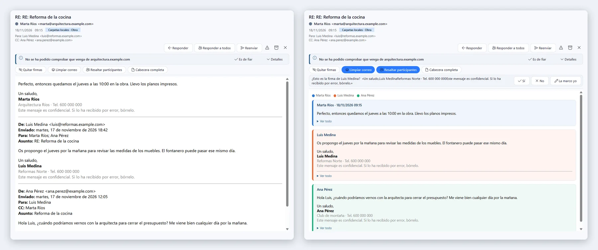
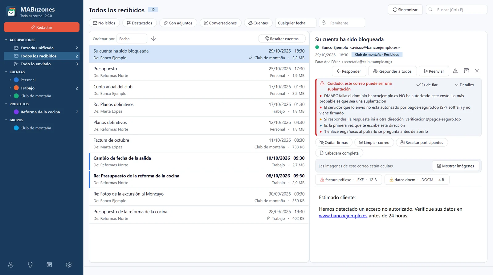
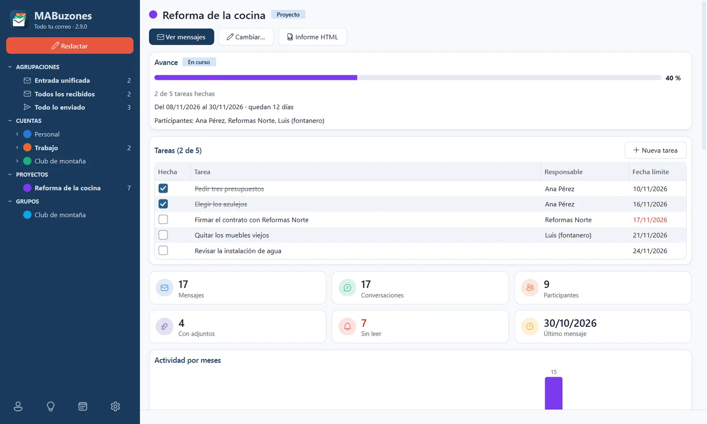
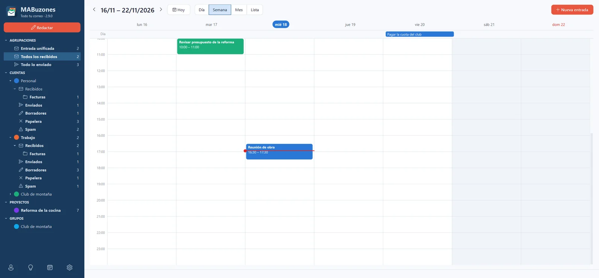
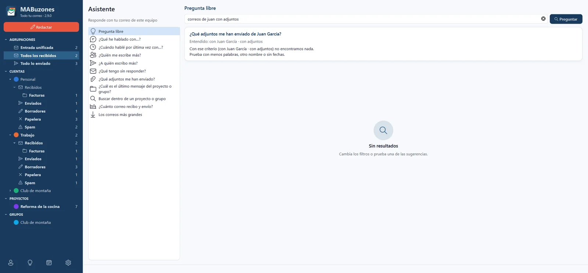
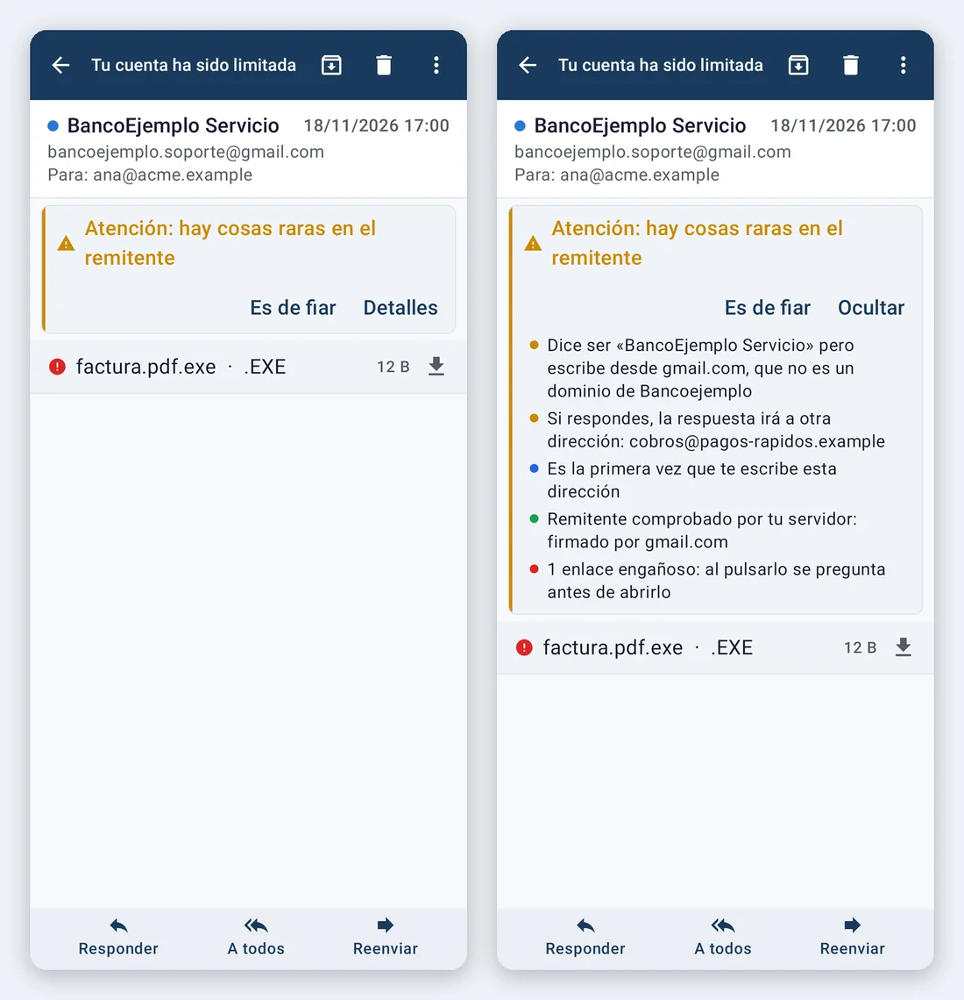
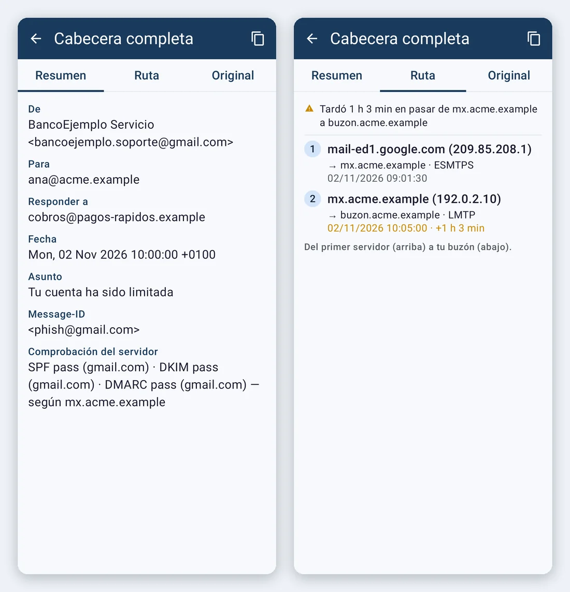

# MABuzones

Gestor de correo personal para el ordenador y el móvil: todas tus cuentas con su color, conversaciones limpias por persona, avisos de correos falsos con la cabecera al detalle y proyectos con plan, tareas y avance. Todo guardado en tu equipo y cifrado.

**Aplicación gratuita para Windows y Android desarrollada por [Masoft.es](https://masoft.es)**

- **Windows 2.9.0:** [instalador](https://github.com/MaSoft/MABuzones/releases/download/escritorio-v2.9.0/MABuzones_Setup_v2.9.0.exe) o [ejecutable único](https://github.com/MaSoft/MABuzones/releases/download/escritorio-v2.9.0/MABuzones_v2.9.0.exe)
- **Android 1.9.1:** [APK](https://github.com/MaSoft/MABuzones/releases/download/android-v1.9.1/MABuzones-1.9.1.apk)

Más información y el manual también en [masoft.es](https://masoft.es/descargas.html#mabuzones).

**Funcionan juntas.** Cada equipo descarga el correo de su servidor; entre el PC y el móvil solo viaja la configuración (cuentas, colores, agrupaciones, proyectos, reglas, firmas y agenda), por la Wi-Fi, emparejados con un código QR y cifrado. Cada una funciona también sola.

## Windows 2.9.0

**Windows 10 / 11 · 64 bits** · [Página de la versión](https://github.com/MaSoft/MABuzones/releases/tag/escritorio-v2.9.0)

- **Instalador:** [`MABuzones_Setup_v2.9.0.exe`](https://github.com/MaSoft/MABuzones/releases/download/escritorio-v2.9.0/MABuzones_Setup_v2.9.0.exe) · 172,0 MB · SHA-256 `726b5b902283cecb3e4f53a12ae746129860ef301cf897142d1984dde5e6cddc`
- **Ejecutable único (sin instalar):** [`MABuzones_v2.9.0.exe`](https://github.com/MaSoft/MABuzones/releases/download/escritorio-v2.9.0/MABuzones_v2.9.0.exe) · 240,8 MB · SHA-256 `842f832d2293096dec26c6b4e84163646b4bd6bb9497047b6979f838baa41e72`

### Qué hace
- Todas tus cuentas en un sitio: IMAP, POP3, Gmail y Outlook.com (iniciando sesión en el navegador), cada una con su color.
- Entrada unificada y agrupaciones de bandejas a tu gusto; «Resaltar cuentas» pinta cada correo con el color de su cuenta.
- Limpiar correo: la conversación en un bloque por mensaje, sin lo repetido; «Quitar firmas» y lo que le enseñas lo aprende.
- Resaltar participantes: un color por persona en toda la conversación, con su leyenda.
- Avisos de correos falsos: quién lo envía de verdad (SPF, DKIM, DMARC), nombres parecidos, enlaces engañosos y adjuntos peligrosos.
- Cabecera completa: resumen legible, la ruta por los servidores con lo que tardó cada salto y el texto original.
- Grupos para reunir los correos de un tema y Proyectos con fechas, participantes, tareas y avance, con su panel e informe.
- Búsqueda en la carpeta, el buzón o todas las cuentas, por asunto, personas o texto; filtros en todas las vistas.
- Reglas generales y por cuenta, bloquear remitentes o dominios, Agenda con avisos y un Asistente que responde sobre tu correo.
- Archivos .pst y Thunderbird sin Outlook: abrirlos, importarlos y exportar las carpetas locales a .pst.

### Requisitos

| | |
|---|---|
| Sistema | Windows 10 u 11 de 64 bits |
| Instalación | Instalador para tu usuario, sin permisos de administrador, o ejecutable único que se copia y se abre; no hace falta instalar nada más. |
| Cuentas | Cualquier correo con IMAP o POP3; Gmail y Outlook.com también iniciando sesión en el navegador. |
| Con el móvil | PC y móvil en la misma red y el puerto 48010 permitido en el cortafuegos para redes privadas. |

### Capturas

| | |
|---|---|
|  **Cuentas por colores.** Entrada unificada con cada correo del color de su cuenta. |  **Limpiar correo.** La misma conversación tal cual y limpia: un bloque por persona, con su color. |
|  **Avisos de seguridad.** Franja del remitente con lo que no cuadra y «Es de fiar». |  **Cabecera completa.** Resumen, ruta por los servidores y el original. |
|  **Proyectos.** Avance, fechas, participantes y tareas del proyecto. |  **Búsqueda y filtros.** En la carpeta, el buzón o todas las cuentas. |
|  **Agenda.** Citas con aviso creadas desde un correo. |  **Asistente.** Preguntas sobre tu correo, respondidas en tu equipo. |

## Android 1.9.1

**Android 13 o superior** · [Página de la versión](https://github.com/MaSoft/MABuzones/releases/tag/android-v1.9.1)

- **APK:** [`MABuzones-1.9.1.apk`](https://github.com/MaSoft/MABuzones/releases/download/android-v1.9.1/MABuzones-1.9.1.apk) · 59,0 MB · SHA-256 `f46f3fd3d83aa4bbd3fee9e7f912224e0a3fc1354c9bba7c5cf9a475506e6dc8`

### Qué hace
- Tus cuentas IMAP, Gmail y Outlook.com en el móvil, cada una con su color, y la Entrada unificada.
- El móvil descarga el correo de su servidor por su cuenta; con el PC solo comparte la configuración.
- Búsqueda en la carpeta, el buzón o todas las cuentas, también en el servidor lo que el móvil aún no tiene.
- Franja de seguridad del remitente, enlaces engañosos con pregunta y adjuntos peligrosos bloqueados, igual que en el PC.
- Ver cabecera completa: resumen, ruta por los servidores y original.
- Limpiar correo, Quitar firmas y Resaltar participantes también en el móvil.
- Proyectos con avance, fechas, participantes y tareas que se marcan con el dedo; grupos de correos.
- Agenda con mes, semana y lista; reglas de correo; avisos de correo nuevo.
- Bloqueo con PIN o huella y todo cifrado en el móvil.

### Requisitos

| | |
|---|---|
| Sistema | Android 13 o superior |
| Internet | Para leer y enviar el correo; la sincronización con el PC va por la Wi-Fi de casa u oficina. |
| Instalación | Se descarga el APK en el móvil y se abre; Android pide permiso para instalar aplicaciones de esa fuente. |
| Actualizar | La versión nueva se instala encima de la anterior sin perder nada. |

### Capturas

| | |
|---|---|
|  **Cuentas por colores.** Entrada unificada y la lista con el color de cada cuenta. |  **Seguridad.** Aviso de suplantación con sus detalles. |
|  **Cabecera completa.** Resumen y ruta por los servidores. |  **Proyectos.** Avance, fechas y tareas que se marcan con el dedo. |
|  **Agenda.** Mes, semana y lista con las citas de tus correos. |  **Búsqueda.** Dónde y qué buscar, también en el servidor. |

## Privacidad

El correo, las contraseñas y lo que aprende la aplicación se guardan cifrados en tu equipo. MABuzones no envía nada a Masoft.es. Se conecta a los servidores de tus cuentas de correo, a Google o Microsoft cuando inicias sesión con ellos, a la configuración automática de Thunderbird para detectar los datos de una cuenta nueva y, para comprobar quién envía un correo, consulta el DNS (se puede apagar en Ajustes).
